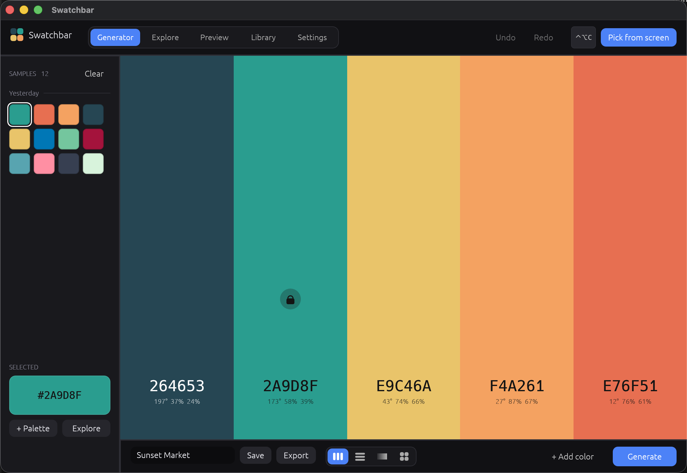
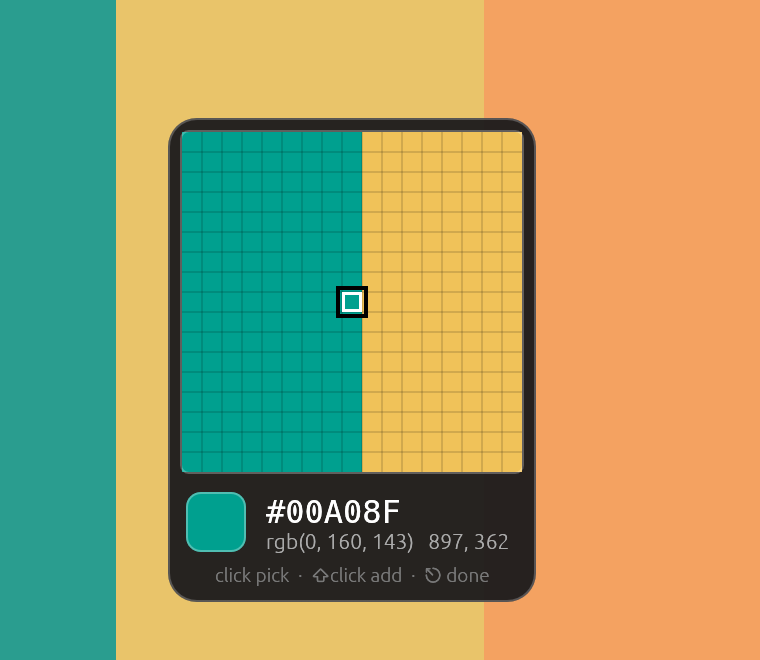
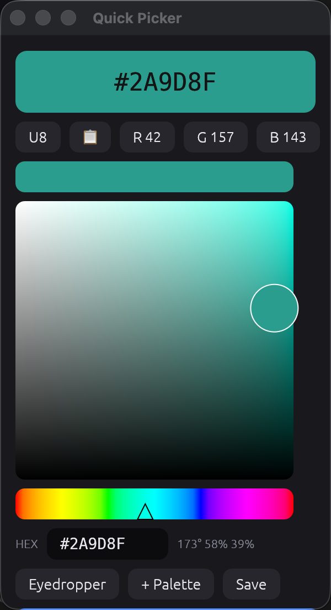
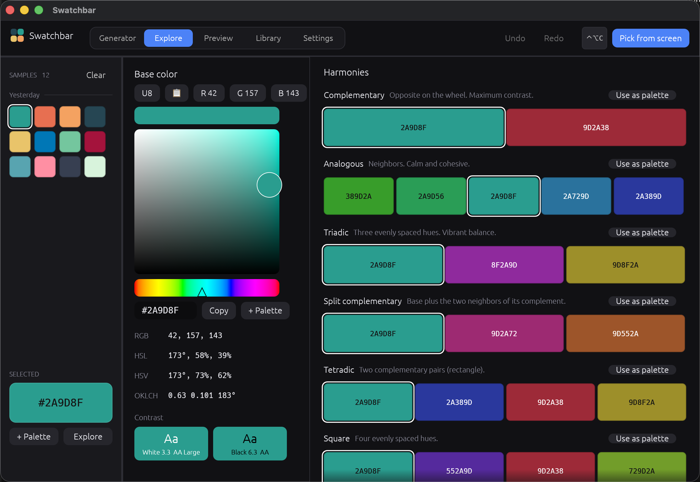
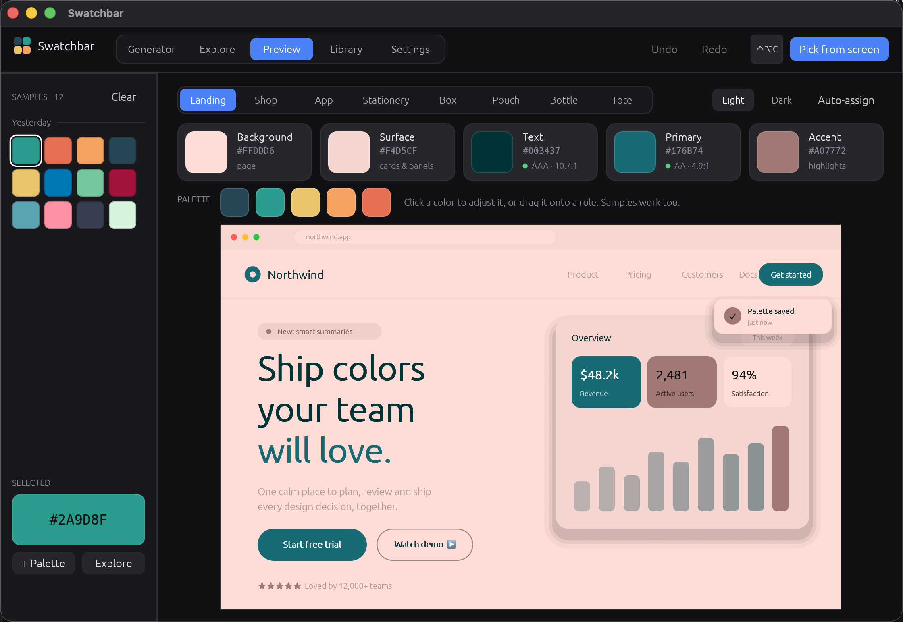
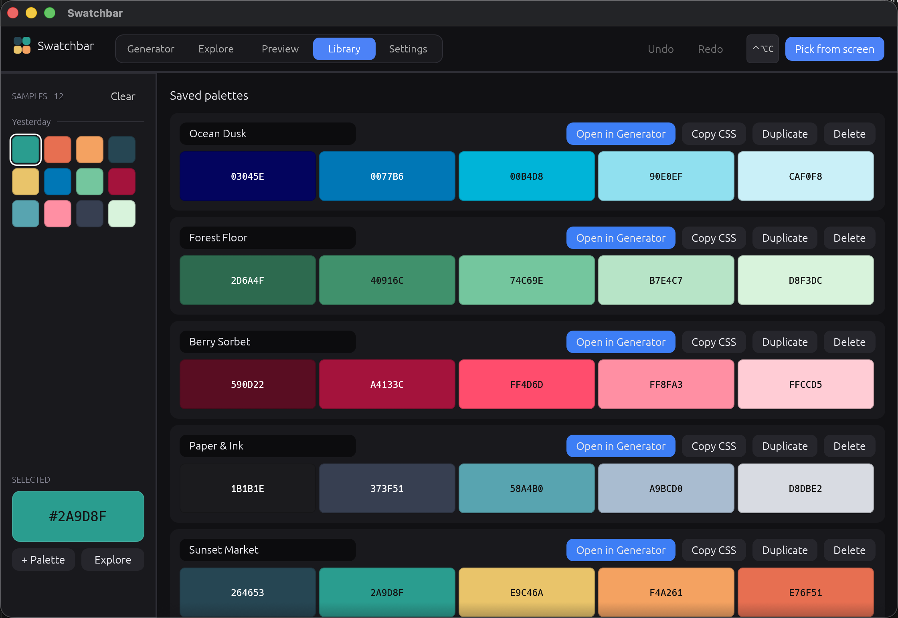
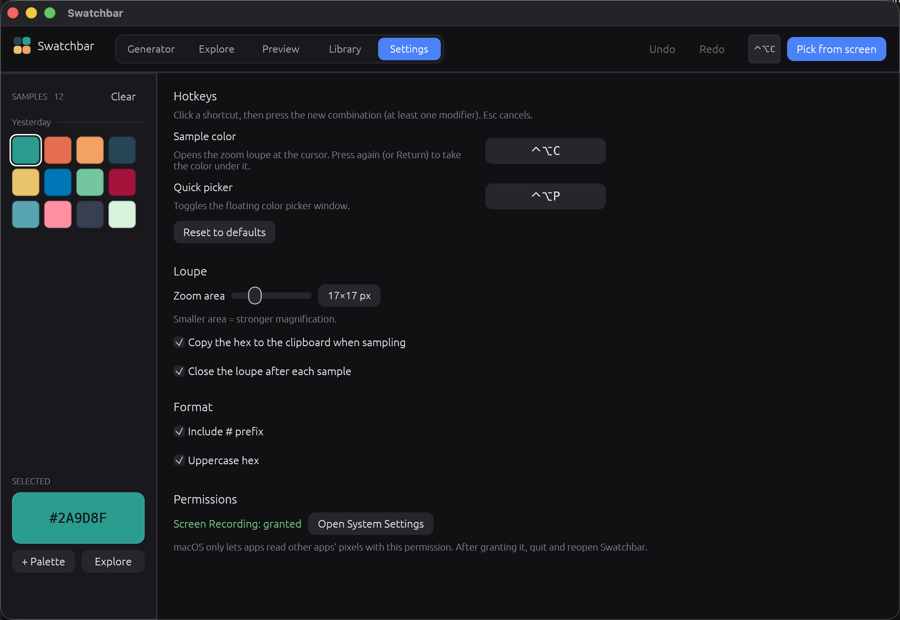
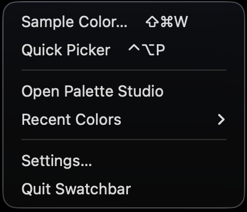

# Swatchbar

A color sampler and palette builder that lives in your menu bar (macOS) or system tray
(Windows, Linux). Pick any pixel on screen with a zoom loupe, then build, explore, preview
and export palettes. Written in Rust with [egui](https://github.com/emilk/egui).



- [Features](#features)
- [Install and build](#install-and-build)
- [Using Swatchbar](#using-swatchbar)
- [Platform notes](#platform-notes)
- [Where your data lives](#where-your-data-lives)
- [Project layout](#project-layout)
- [Development](#development)

## Features

- **Screen sampler.** A global hotkey opens a magnifying loupe at the cursor. Click (or press
  the hotkey again) to take the color. The hex is copied to the clipboard and added to your
  Samples list. Colors are converted to sRGB so they match CSS and Figma.
- **Quick Picker.** A small always-on-top window with an HSV picker, hex entry, eyedropper,
  recent samples and your working palette, on its own hotkey.
- **Palette Generator.** Press Space for a new batch of harmonious colors, lock the ones you
  like, drag to reorder, and view the palette as columns, rows, a gradient or a grid.
- **Explore.** Harmonies (complementary, analogous, triadic, split-complementary, tetradic,
  square, monochrome), shade / tint / tone ladders, RGB / HSL / HSV / OKLCH readouts and
  WCAG contrast checks.
- **Preview.** Assign colors to five roles and watch real-looking designs update: a landing
  page, shop, app and stationery, plus packaging photos (box, pouch, bottle, tote) that are
  recolored to your scheme.
- **Library.** Save palettes, rename them, reopen them in the Generator, duplicate them, or
  copy them as CSS variables.
- **Export** as a hex list, CSS variables, a CSS gradient or JSON.
- **Your OS, your conventions.** Native tray / menu-bar icon, global hotkeys you can rebind,
  and a recent-colors menu where a click copies the hex.

## Install and build

You need a recent stable [Rust toolchain](https://rustup.rs). Prebuilt binaries for all three
platforms are attached to each [GitHub release](../../releases) and built by CI on every push.

### macOS

```sh
./bundle.sh                 # builds target/Swatchbar.app (menu-bar only, no Dock icon)
open target/Swatchbar.app
```

On the first sample, macOS asks for **Screen Recording** permission (System Settings >
Privacy & Security). Grant it, then quit and reopen Swatchbar. Run Swatchbar from the `.app`
so the permission sticks to Swatchbar rather than to your terminal.

Optional: `./make_cert.sh` creates a local "Swatchbar Dev" signing identity that `bundle.sh`
uses automatically. A stable identity keeps macOS from asking for permission again after every
rebuild.

When clicking to pick a color, macOS also asks for **Accessibility** access. Without it
the click still picks the color but also reaches the app underneath.

### Windows

```powershell
./bundle_windows.ps1        # builds target\Swatchbar-windows.zip
```

No permissions are needed. The icon appears in the notification area (check the `^` overflow
if you don't see it).

### Linux

```sh
sudo apt install pkg-config libgtk-3-dev libayatana-appindicator3-dev libxdo-dev libxkbcommon-dev
./bundle_linux.sh           # builds target/swatchbar-linux-<arch>.tar.gz
```

The tarball holds the binary, a `.desktop` file and an icon. Needs an X11 session; see
[Platform notes](#platform-notes).

## Using Swatchbar

### Sampling colors

| Action | macOS | Windows / Linux |
| --- | --- | --- |
| Open the loupe | `⌃⌥C` | `Ctrl+Alt+C` |
| Open the Quick Picker | `⌃⌥P` | `Ctrl+Alt+P` |

Both hotkeys can be changed in **Settings**.



With the loupe open:

| Input | Result |
| --- | --- |
| Click, `Return`, or the hotkey again | Take the color, copy it, add it to Samples |
| `Shift`+click | Add the color to the working palette and keep sampling |
| Arrow keys | Nudge the cursor 1 px (hold `Shift` for 10 px) |
| `Esc` or right-click | Cancel |

The loupe magnifies a square grid of real pixels (17x17 by default) with the center pixel
outlined, and shows the RGB value and cursor position. A short chip near the cursor confirms
what was copied. You can change the loupe size and whether it closes after each sample in
Settings.

### Quick Picker



Press the picker hotkey for a floating window next to your cursor. Drag in the field to set
saturation and value, drag the hue strip, type a hex, or press **Eyedropper** to sample from
the screen. **+ Palette** adds the color to your working palette. `Esc` closes it, and **Copy & close**
copies the color, adds it to your history and closes the window.

### Generator


- **Space** (or **Generate**) rolls a new palette. Locked colors stay put.
- Click a swatch to select it and adjust it in a color window with a wheel plus HSL, RGB,
  OKLCH and CMYK sliders. Click the hex to type a value.
- Drag swatches to reorder them with a live preview. Insert a new color between two columns.
- Drag a color from the **Samples** list on the left into the palette.
- Switch between **Columns**, **Rows**, **Gradient** and **Grid** layouts from the bottom bar.
- **Undo / Redo** with `Cmd+Z` / `Cmd+Shift+Z` (`Ctrl+Z` / `Ctrl+Shift+Z` on Windows and Linux).
- **Save** stores the palette in the Library. **Export** copies it in the format you pick.

A palette holds up to 10 colors.

### Explore



Pick any base color (from the picker, the Samples list, or the Generator) to see its color
values, contrast against white and black with WCAG ratings, and every standard harmony.
**Use as palette** turns a harmony into your working palette. The shade viewer shows lighter
and darker ladders of the selected color.

### Preview



The five roles are **Background**, **Surface**, **Text**, **Primary** and **Accent**. Click a
role to adjust it, or drag any color onto it. Text and Primary show their contrast rating
against the background. **Auto-assign** picks sensible roles from your palette, and **Light / Dark**
flips the scheme. The mockups (Landing, Shop, App, Stationery) are painted live. The packaging
scenes (Box, Pouch, Bottle, Tote) recolor photographs while keeping their lighting, shadows
and folds.

### Library



Every saved palette lists its name (click to rename) and swatches. **Open in Generator**
loads it, **Copy CSS** copies it as CSS variables, **Duplicate** makes a copy and **Delete**
removes it.

### Settings



Rebind both hotkeys (click one, then press the new combination with at least one modifier),
set the loupe size, choose whether sampling copies to the clipboard, and set the hex format
(`#` prefix, uppercase). On macOS this tab also shows the Screen Recording permission status.

### The tray / menu-bar icon



The icon menu has **Sample Color…**, **Quick Picker**, **Open Palette Studio**, a
**Recent Colors** submenu (click a color to copy its hex), **Settings…** and **Quit**.

## Platform notes

| | macOS | Windows | Linux |
| --- | --- | --- | --- |
| Screen capture | CoreGraphics (needs Screen Recording) | GDI | X11 `GetImage` |
| Click-to-pick without leaking the click | Event tap (needs Accessibility) | Low-level mouse hook | Active pointer grab |
| Tray | Menu-bar template icon | Notification area | Status notifier (AppIndicator) |
| Hotkey labels | `⌃⌥C` | `Ctrl+Alt+C` | `Ctrl+Alt+C` |

**Linux.** Swatchbar runs on X11 (it forces the X11 backend, so it also starts under XWayland).
Wayland doesn't let apps read other windows' pixels or the global cursor position, so
sampling is disabled there and the app says so. To use it on a Wayland desktop, log in with an
X11 session. The tray icon needs a status-notifier host; GNOME needs the AppIndicator
extension. If another app already holds a pointer grab (an open menu, for example), the click
still picks a color but also reaches the app underneath.

**Windows.** The process is per-monitor DPI aware, so the loupe samples physical pixels.
Mixed-DPI multi-monitor setups may place the loupe and picker slightly off.

**Scaling on X11.** If you run with a UI scale other than 1, set `GDK_SCALE` or
`WINIT_X11_SCALE_FACTOR` so the loupe lines up with the cursor.

## Where your data lives

Settings, history, saved palettes and your working palette are one `state.json` file in the
OS config folder:

| OS | Path |
| --- | --- |
| macOS | `~/Library/Application Support/Swatchbar/state.json` |
| Windows | `%APPDATA%\Swatchbar\state.json` |
| Linux | `~/.config/Swatchbar/state.json` |

Nothing is sent over the network.

## Project layout

```
src/
  main.rs         window + event-loop setup per OS
  app.rs          App state, message handling, sampling flow
  capture.rs      screen-sampling API shared by every OS
  clicktap.rs     click-capture API shared by every OS
  platform/       per-OS backends for the two above
                    macos_*.rs, windows_*.rs, linux_*.rs
  tray.rs         tray / menu-bar icon and menu
  hotkeys.rs      global hotkey parsing, labels, registration
  studio.rs       the Palette Studio window and its tabs
  views.rs        Generator layouts and drag-to-reorder
  adjust.rs       the Adjust color window
  preview.rs      role assignment and mockup scenes
  mockups.rs      painted landing / shop / app / stationery scenes
  transfer.rs     recolors the packaging photos to your scheme
  color.rs        color math, harmonies, generation
  store.rs        settings and saved data
  picker.rs       Quick Picker window
  loupe.rs        zoom loupe
assets/           app icon, packaging photos, Blender scene sources
packaging/linux/  .desktop file
docs/             README screenshots
```

## Development

```sh
cargo run                    # run from the terminal (macOS: screen permission attaches to the terminal)
cargo test                   # unit tests
cargo test -- --ignored      # also run the screen-capture tests (needs a display and permission)
```

CI (`.github/workflows/build.yml`) builds and tests on macOS, Windows and Linux for every push
and pull request. Pushing a tag like `v0.1.0` also publishes the three packages to a GitHub
release.

### Regenerating the screenshots

`SWATCHBAR_SHOTS=<dir>` puts the app in a screenshot mode: it steps through the tabs, the
picker and the loupe, writes the current step's name to `<dir>/current`, and moves on when you create
`<dir>/next`. Take each capture with any screenshot tool while it waits. Point your home
folder at a scratch directory containing [`docs/demo-state.json`](docs/demo-state.json) as
`state.json` so the shots use demo data (on macOS, `$HOME/Library/Application Support/Swatchbar/`):

```sh
HOME=/tmp/swatchbar-demo SWATCHBAR_SHOTS=/tmp/swatchbar-shots ./target/release/swatchbar
```

## License

No license has been chosen yet.
